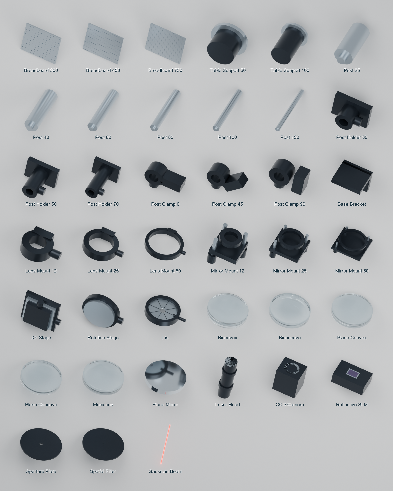
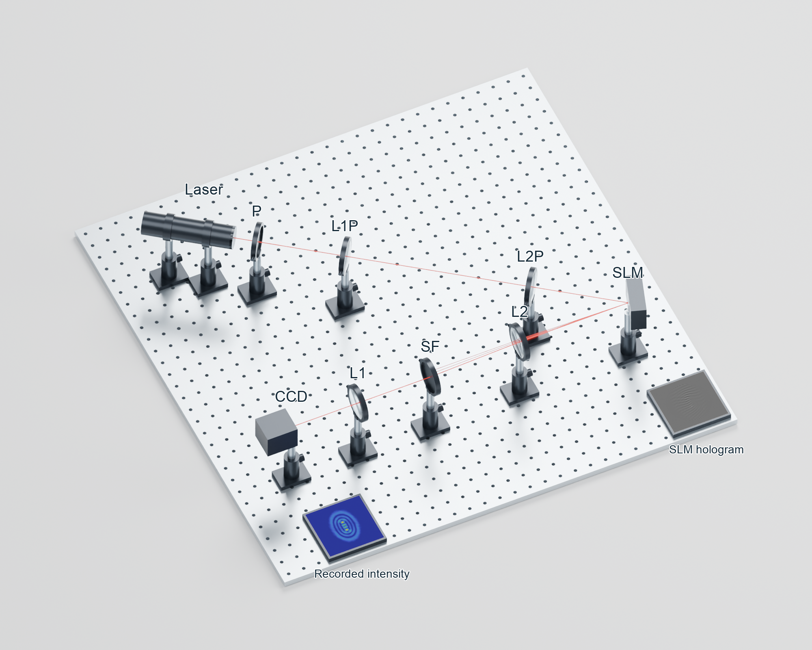

# Blender Optical Experiments

[](https://doi.org/10.5281/zenodo.23997720)



39 independently authored Blender collection assets for optical-bench visualization: perforated plates, supports, posts, holders, mounts, stages, generic lens shapes, instruments and a Gaussian beam representation.

**Authors:** B. M. Rodriguez-Lara and J. Escamilla Angeles. See [AUTHORS.md](AUTHORS.md).

## Start here

1. Extract the complete project folder. Keep `library/`, `agent/`, `scripts/` and `examples/` together.
2. In Blender Preferences, add `library/` to Asset Libraries. Use collection instances at unit scale: one Blender unit is one meter.
3. Open the project folder in Codex. Ask it to read `agent/setup-to-blender/SKILL.md` and execute `examples/paper-setup/prompt.md`.
4. Follow the [step-by-step user guide](docs/user-guide.pdf), with [editable LaTeX source](docs/user-guide.tex).

The [asset metadata](docs/assets.json) describes dimensions and placement axes. The cover normalizes display sizes for browsing; source dimensions are preserved. The [catalogue SVG](images/catalogue-lettered.svg) has editable lettering over an embedded raster render.

## Reproduce the example directly

With Blender available as `blender`, run from the project root (choose an unused dated figure folder):

```sh
blender --background --python scripts/build_generic_example.py -- --output Figures/2026-11-05-FIg01
python3 scripts/export_example.py Figures/2026-11-05-FIg01
```

The exporter needs Pillow. On macOS replace `blender` with `/Applications/Blender.app/Contents/MacOS/Blender`; on Windows use the installed `blender.exe` path. Outputs include an editable scene with packed image textures, perspective and plan PNGs, paired 86 mm SVGs, source, scene metadata and validation notes.



The paper's basic 2D schematic inspired this project. These Blender models were created afterward and were not used in or supplied with the paper (DOI 10.1103/6ftp-svh8). The bundled SLM/CCD panels are supplied reference images, not simulations.

## Design inspiration

These independently created generic models are inspired by common laboratory optomechanics, including equipment manufactured by Thorlabs. They use generic geometric forms and illustrative dimensions. No manufacturer CAD geometry is included in these models. This project is not affiliated with or endorsed by Thorlabs, and the models are not certified product replicas.

## Scope, license and citation

Original code: MIT. Original generic models and documentation: CC BY 4.0. Supplied reference images retain their existing rights. See [LICENSE](LICENSE) and [provenance](docs/provenance.md). Beam envelopes are visualization aids, not diffraction simulations. Dimensions and fits are illustrative, not manufacturing specifications.

## How to cite

Rodriguez-Lara, B. M., & Escamilla Angeles, J. (2026). Blender Optical Experiments [Computer software]. Zenodo. https://doi.org/10.5281/zenodo.23997720

Permanent project DOI (all versions): [10.5281/zenodo.23997720](https://doi.org/10.5281/zenodo.23997720).

Download [BibTeX](docs/citations/experiments-project.bib), [RIS](docs/citations/experiments-project.ris), [CSL-JSON](docs/citations/experiments-project.csl.json), or [plain text](docs/citations/experiments-project.txt). These cite the project without tying it to a particular release. The scientific paper has a separate citation.

## Rebuild

`scripts/build_generic_library.py` rebuilds the original library from primitives; preserve manual edits before running it. `scripts/build_generic_catalogue.py` creates its cover. The user guide compiles with two runs of `pdflatex user-guide.tex` from `docs/`.
